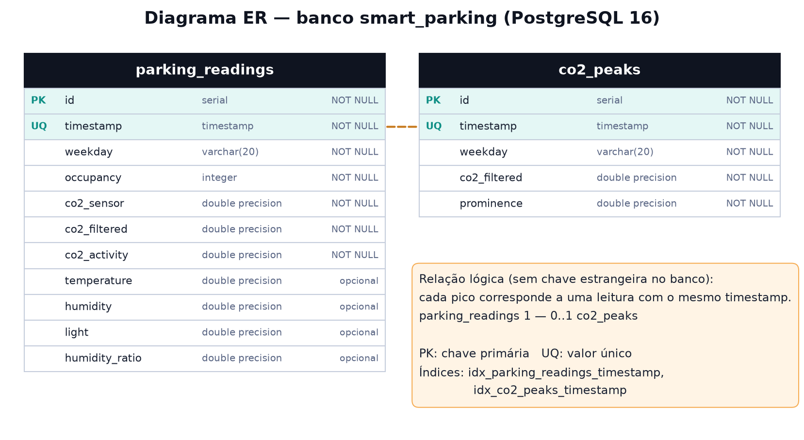

# Instruções do banco de dados

PostgreSQL 16, executado em Docker. Banco `smart_parking`, usuário `parking`.
A senha de demonstração local está em `.env.example`.

## Arquivos desta pasta

| Arquivo | Para que serve |
|---|---|
| `schema.sql` | Cria as tabelas e os índices |
| `seed.sql` | Insere os dados (20.560 leituras e 30 picos). Precisa das tabelas criadas |
| `dump/smart_parking_dump.sql` | Backup: dump completo (estrutura e dados). Recria as duas tabelas |
| `diagrama-er.png` | Diagrama entidade-relacionamento |

O banco em si é criado pelo Docker Compose. Os scripts acima criam as tabelas dentro dele.

## 1. Subir o banco

Abra o PowerShell na pasta do projeto e rode um comando por vez:

```powershell
docker compose up -d --wait
```

Na primeira inicialização, o `schema.sql` é executado automaticamente.

## 2. Importar os dados (escolha UMA opção)

### Opção A: restaurar o backup (recomendada)

```powershell
docker cp db\dump\smart_parking_dump.sql smart_parking_postgres:/tmp/backup.sql
```

```powershell
docker exec smart_parking_postgres psql -U parking -d smart_parking -v ON_ERROR_STOP=1 -f /tmp/backup.sql
```

O backup apaga e recria as tabelas `parking_readings` e `co2_peaks`.

### Opção B: schema + seed

```powershell
docker cp db\schema.sql smart_parking_postgres:/tmp/schema.sql
```

```powershell
docker cp db\seed.sql smart_parking_postgres:/tmp/seed.sql
```

```powershell
docker exec smart_parking_postgres psql -U parking -d smart_parking -v ON_ERROR_STOP=1 -f /tmp/schema.sql
```

```powershell
docker exec smart_parking_postgres psql -U parking -d smart_parking -q -v ON_ERROR_STOP=1 -f /tmp/seed.sql
```

O `seed.sql` apaga o conteúdo das duas tabelas antes de inserir.

## 3. Conferir

```powershell
docker exec smart_parking_postgres psql -U parking -d smart_parking -c "SELECT (SELECT COUNT(*) FROM parking_readings) AS leituras, (SELECT COUNT(*) FROM co2_peaks) AS picos;"
```

Resultado esperado: **20560** leituras e **30** picos.

## Observações

- Importe com o `psql`, como acima. Os arquivos exportados usam comandos próprios dele.
- Sem Docker: em um PostgreSQL 16 atualizado, crie um banco vazio e execute o backup com o `psql`.
  Ajuste o arquivo `.env` com os dados da sua conexão.

## Diagrama ER



## Gerar um novo backup

No PowerShell, o redirecionamento `>` corrompe o arquivo. Por isso, o dump é feito dentro do container:

```powershell
docker exec smart_parking_postgres pg_dump -U parking --clean --if-exists --no-owner --no-privileges -f /tmp/dump.sql smart_parking
```

```powershell
docker cp smart_parking_postgres:/tmp/dump.sql db\dump\smart_parking_dump.sql
```
